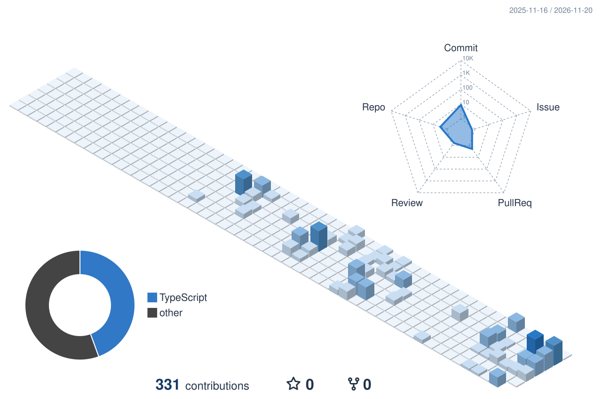

# Soowang Lee | 이수왕

I am Soowang Lee (이수왕), researching consensus, maritime data integrity, and security protocols.
Master's student at [SAVE Lab](https://sites.google.com/view/save-lab/home), Department of AI Convergence Engineering, [Gyeongsang National University](https://www.gnu.ac.kr/eng/main.do).
[ORCID](https://orcid.org/0009-0004-6088-5450) · [Research record](https://sites.google.com/view/save-lab/publication)

## Research Interests

- **PBFT and Byzantine fault tolerance:** How can replicated systems reach reliable agreement despite faulty participants?
- **Maritime / ENC integrity and recovery:** How can ships detect inconsistent chart updates and recover trusted data?
- **IIoT event consistency:** How can industrial sensors agree on event records across independent groups?
- **Security protocol analysis:** How can formal methods expose weaknesses in authentication and communication protocols?
- **EV charging infrastructure security:** What security requirements protect charging systems and their connected components?

## Selected Journal Publications

### 1. [Group-Based Consensus Scheme for Sensor-Event Consistency in Industrial IoT Environments](https://doi.org/10.3390/s26175611)

Soowang Lee, Seungbin Lee, and Jiyoon Kim. *Sensors*, 26(17), 5611, 2026. **Published · First author**

This paper validates event digests before PBFT agreement within independent sensor groups.
[Full text](https://pmc.ncbi.nlm.nih.gov/articles/PMC13568240/)

### 2. A PBFT-Based Consensus Approach for Enhancing ENC Updates

Soowang Lee, Seungbin Lee, and Jiyoon Kim. *IEICE Transactions on Information and Systems*. **Accepted · First author**

### 3. [Survey on Electric Vehicle Charging Systems: Derivation of Security Requirements and Research Directions](https://doi.org/10.64799/rebicte.V11.9)

Soowang Lee and Jiyoon Kim. *Research Briefs on Information and Communication Technology Evolution*, 11, 150–158, 2025. **Published · First author**

This paper reviews charging-system structures, security threats, and countermeasures.
It derives security requirements and identifies future research directions.
[Publisher](https://rebicte.org/index.php/rebicte/article/view/219)

## Selected International Conference Contributions

### 1. PBFT-Based Lightweight Consensus Scheme for Sensor Event Consistency in Industrial IoT

Soowang Lee, Dayun Oh, and Jiyoon Kim. WISA 2026, the 27th World Conference on Information Security Applications. **Poster · First author**

### 2. [Survey on Electric Vehicle Charging Stations: System and Security Perspectives](https://doi.org/10.1007/978-3-032-26616-3_8)

Soowang Lee, Seungbin Lee, Kyung A. Kang, Joo Hyeon Lee, and Jiyoon Kim. EBISION 2025, the First IFIP WG 8.4 International Symposium on E-Business Information Systems Evolution. **Oral · First author**

IFIP Advances in Information and Communication Technology, vol. 786, pp. 111–125. Online publication: 2026; citation year: 2027.

## Selected Domestic Conference Contributions & Awards

### 1. ENC 불일치 보고를 위한 PBFT 기반 선박 간 합의 구조

이수왕, 김지윤. 2026년 한국제조데이터인공지능학회 추계 종합학술대회 및 학부논문 경진대회. **Oral · First author · [우수논문상](https://sites.google.com/view/save-lab/home)**

### 2. ECDIS 환경에서 PBFT와 Merkle Tree를 활용한 ENC 복구 프레임워크

이수왕, 김지윤. 2026년 한국정보보호학회 동계학술대회 CISC-W’26. **Oral (lab listing) · First author**

### 3. 금융보안 관점에서의 양자내성암호 전환 로드맵과 이행 전략에 관한 고찰

이수왕, 김지윤. 2026년 한국정보보호학회 하계학술대회 CISC-S’26. **Oral · First author**

### 4. [위치 요소 기반 사용자 인증 프로토콜에 대한 정형검증 연구](https://www.dbpia.co.kr/journal/articleDetail?nodeId=NODE12025178)

이수왕, 이주현, 김지윤. 2024년 한국정보기술학회 추계종합학술대회 및 대학생논문경진대회. **Oral · First author · [대학생 논문경진대회 은상](https://www.gnu.ac.kr/cse/na/ntt/selectNttInfo.do?bbsId=4783&mi=17233&nttSn=2263399)**

## Selected Projects

### [AlimExpress / 알림 익스프레스](https://github.com/GNU-CSE-AlimExpress/alimexpress-data)

A personalized service for subscribing to web documents and receiving recommendations.
**Role:** Android frontend developer. Built recommendation browsing, quizzes, reactions, and notification flows.
Improved notification caching, navigation, UI, and loading experience.

### [Invisible Hand / 보이지 않는 손](https://github.com/GNU-CSE-Invisible-Hand)

**Role:** Android frontend developer.

### Redirect / 리다이렉트

**Role:** Microservices architecture design and implementation.

### [cs-on-the-go](https://github.com/rrkim/cs-on-the-go)

A campus meal schedule service.
**Role:** Implemented the meal schedule page and home-page meal section.
[Contribution record](https://github.com/rrkim/cs-on-the-go/pull/14)

### [Sophie](https://github.com/UMC-5th-Hackathon-N-Team) · [FE-web](https://github.com/UMC-5th-Hackathon-N-Team/FE-web) · [FE-iOS](https://github.com/UMC-5th-Hackathon-N-Team/FE-iOS)

A hackathon service for keeping blood donation records.
**Role:** Project manager and designer at the UMC 5th Hackathon.

## Additional Research

- International journal articles: 1
- Domestic journal articles: 1
- International conference contributions: 4
- Domestic conference contributions: 5

## Tools & Activity

Firebase Cloud Messaging · Git · GitHub

[Contribution activity](https://github.com/mildliner?tab=overview)

<picture>
  <source media="(prefers-color-scheme: dark)" srcset="https://raw.githubusercontent.com/mildliner/mildliner/main/assets/activity-dark.svg">
  <source media="(prefers-color-scheme: light)" srcset="https://raw.githubusercontent.com/mildliner/mildliner/main/assets/activity-light.svg">
  
</picture>
