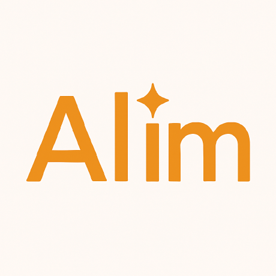

# Soowang Lee (이수왕)

**Master's Student · Department of AI Convergence Engineering**  
Gyeongsang National University · SAVE Lab

PBFT, data integrity, and security for maritime, industrial IoT, and EV charging systems.

[ORCID](https://orcid.org/0009-0004-6088-5450) · [SAVE Lab](https://sites.google.com/view/save-lab/home) · [Lab Members](https://sites.google.com/view/save-lab/member) · [Publications](https://sites.google.com/view/save-lab/publication)

---

## Research Interests

- **PBFT and Byzantine fault tolerance:** How can consensus remain lightweight while preserving consistency?
- **Maritime ENC integrity and recovery:** How can vessels detect inconsistent chart data and recover trustworthy updates?
- **IIoT sensor-event consistency:** How can independent sensor groups validate events before reaching agreement?
- **Security protocol analysis:** How can formal methods reveal weaknesses in authentication protocols?
- **EV charging security:** What security requirements follow from charging-system architectures and threats?

---

## Publications & Preprints

### Selected Journal Articles

- **[Group-Based Consensus Scheme for Sensor-Event Consistency in Industrial IoT Environments](https://doi.org/10.3390/s26175611)**  
  **Soowang Lee**, Seungbin Lee, Jiyoon Kim · *Sensors*, 26(17), 5611 (2026) · Published · First author · [Paper](https://pmc.ncbi.nlm.nih.gov/articles/PMC13568240/)  
  This paper validates event digests before PBFT agreement within independent sensor groups.
- **A PBFT-Based Consensus Approach for Enhancing ENC Updates**  
  **Soowang Lee**, Seungbin Lee, Jiyoon Kim · *IEICE Transactions on Information and Systems* · Accepted · First author
- **[Survey on Electric Vehicle Charging Systems: Derivation of Security Requirements and Research Directions](https://doi.org/10.64799/rebicte.V11.9)**  
  **Soowang Lee**, Jiyoon Kim · *Research Briefs on Information and Communication Technology Evolution (ReBICTE)*, 11, 150–158 (2025) · Published · First author · [Article](https://rebicte.org/index.php/rebicte/article/view/219)  
  Reviews charging-system structures, threats, and countermeasures to derive security requirements and research directions.

Co-authored journal articles

#### International journal

- **[Exploring Authentication Protocols for Secure and Efficient Internet of Medical Things Systems](https://doi.org/10.3390/electronics14214164)**  
  Seungbin Lee, Kyeong A. Kang, **Soowang Lee**, Jiyoon Kim · *Electronics*, 14(21):4164 (2025) · Published

#### Domestic journal

- **[Delightex를 활용한 중학생들의 VR 콘텐츠 개발을 위한 교육 프로그램 개발](https://www.kci.go.kr/kciportal/landing/article.kci?arti_id=ART003337282)**  
  박현택, **이수왕**, 김지윤 · *과학영재교육*, 18(1):238–248 (2026) · Published

### Conference Contributions

#### International conferences (2)

- **PBFT-Based Lightweight Consensus Scheme for Sensor Event Consistency in Industrial IoT**  
  **Soowang Lee**, Dayun Oh, Jiyoon Kim · *The 27th World Conference on Information Security Applications (WISA 2026)* · Poster · First author
- **Survey on Electric Vehicle Charging Stations: System and Security Perspectives**  
  **Soowang Lee**, Seungbin Lee, Kyung A. Kang, Joo Hyeon Lee, Jiyoon Kim · *The First IFIP WG 8.4 International Symposium on E-Business Information Systems Evolution (EBISION 2025)* · Oral · First author · *IFIP Advances in Information and Communication Technology*, vol. 786, pp. 111–125 · [Paper](https://doi.org/10.1007/978-3-032-26616-3_8)  
  Symposium: 2025 · Online publication: August 2, 2026 · Final citation year: 2027

Co-authored international conference contributions

- **[Research Trends and Use Cases on Security for Non-Terrestrial Networks](https://www.earticle.net/Article/A468842)**  
  Seungbin Lee, **Soowang Lee**, Jiyoon Kim · *The 10th International Conference on Next Generation Computing (ICNGC 2024)* (2024) · Oral
- **[A PBFT-Based Consensus Approach for Secure ENC Update Protocol](https://di0zxmb8pwajl.cloudfront.net/kiisc/conference/mobisec2025/programbook/58.pdf)**  
  Seungbin Lee, **Soowang Lee**, Jiyoon Kim · *Proceedings of the 9th International Conference on Mobile Internet Security (MobiSec ’25)*, Article 58 (2025) · Oral
- **[An Integrated SCA–SAST Framework for Open-Source Software Security Analysis and Risk Assessment](https://sites.google.com/view/save-lab/publication)**  
  Joohyeon Lee, Jaekyeom Kim, **Soowang Lee**, Jiyoon Kim · *The 10th International Conference on Mobile Internet Security (MobiSec 2026)* (2026) · Poster · Accepted
- **[Beyond Quishing: A Comprehensive Survey of Security Threats and Countermeasures in QR Code](https://sites.google.com/view/save-lab/publication)**  
  Seungbin Lee, **Soowang Lee**, Jiyoon Kim · *The 8th International Conference on Computer Communication and the Internet (ICCCI 2026)* (2026) · Poster
- **[Design and Implementation of a Virtual Reality-Based Electronic Voting System](https://doi.org/10.1109/VRW70859.2026.00212)**  
  Hyuntaek Park, **Soowang Lee**, Jiyoon Kim · *Proceedings of the 2026 IEEE Conference on Virtual Reality and 3D User Interfaces Abstracts and Workshops (VRW 2026)* (2026) · Poster

#### Domestic conferences (4)

- **ENC 불일치 보고를 위한 PBFT 기반 선박 간 합의 구조**  
  **이수왕**, 김지윤 · 2026년 한국제조데이터인공지능학회 추계 종합학술대회 및 학부논문 경진대회 · Oral · First author · [우수논문상](https://sites.google.com/view/save-lab/home)
- **ECDIS 환경에서 PBFT와 Merkle Tree를 활용한 ENC 복구 프레임워크**  
  **이수왕**, 김지윤 · 2026년 한국정보보호학회 동계학술대회 (CISC-W’26) · Oral (lab listing) · First author
- **금융보안 관점에서의 양자내성암호 전환 로드맵과 이행 전략에 관한 고찰**  
  **이수왕**, 김지윤 · 2026년 한국정보보호학회 하계학술대회 (CISC-S’26) · Oral · First author
- **위치 요소 기반 사용자 인증 프로토콜에 대한 정형검증 연구**  
  **이수왕**, 이주현, 김지윤 · 2024년 한국정보기술학회 추계종합학술대회 및 대학생논문경진대회 · Oral · First author · 대학생논문경진대회 은상 · [논문](https://www.dbpia.co.kr/journal/articleDetail?nodeId=NODE12025178) · [수상 안내](https://www.gnu.ac.kr/cse/na/ntt/selectNttInfo.do?bbsId=4783&mi=17233&nttSn=2263399)

Co-authored domestic conference contributions

- **[마이크로서비스 아키텍쳐 기반 플랫폼 성능 개선 연구](https://www.earticle.net/Article/A468948)**  
  김량래, **이수왕**, 여찬욱, 김지윤 · *2025 한국차세대컴퓨팅학회 춘계학술대회* (2025) · Poster Session
- **[전기 자동차 충전 시스템을 위한 효율적인 인증 기법 연구](https://www.manuscriptlink.com/society/kiisc/conference/ciscs2025/programBook)**  
  이승빈, **이수왕**, 김지윤 · 2025년 한국정보보호학회 동계학술대회 (CISC-W’25) (2025) · Oral
- **Linux 관리자 Task 절차 이탈 탐지에서 Task 조건과 행동 표현 방식에 따른 탐지 특성 분석**  
  김재겸, **이수왕**, 김지윤 · 2026년 한국정보보호학회 영남지부 학술대회 (2026) · Poster · [SAVE Lab publication list](https://sites.google.com/view/save-lab/publication)

---

## Engineering & Projects

| Project & Links | Role & Contribution |
|---|---|
|  **AlimExpress (알림익스프레스)** Personalized web-document subscription and recommendation service. [Public team data repository](https://github.com/GNU-CSE-AlimExpress/alimexpress-data) | Android frontend. Contributed to recommendations, quizzes, and reactions. Implemented FCM notifications, caching, and UI loading improvements. |
|  **Invisible Hand (보이지 않는 손)** [Public organization](https://github.com/GNU-CSE-Invisible-Hand) · [Public data repository](https://github.com/GNU-CSE-Invisible-Hand/invisiblehand-data) | Android frontend role. |
| **Redirect (리다이렉트)** | Microservices architecture design and implementation role. |
|  **cs-on-the-go** Campus meal schedules. [Repository](https://github.com/rrkim/cs-on-the-go) · [Contribution](https://github.com/rrkim/cs-on-the-go/pull/14) | Contributed the meal page, main meal section, and screen improvements. |
|  **Sophie** UMC 5th Hackathon · Blood donation records. [FE-web](https://github.com/UMC-5th-Hackathon-N-Team/FE-web) · [FE-iOS](https://github.com/UMC-5th-Hackathon-N-Team/FE-iOS) | Project manager and designer. The public interface includes blood donation records. |

---

## Contribution Activity

<!-- 라이트와 다크 중 현재 테마에 맞는 기존 활동 그래프 SVG를 표시합니다. -->

<picture>
  <source media="(prefers-color-scheme: dark)" srcset="https://raw.githubusercontent.com/mildliner/mildliner/main/assets/activity-dark.svg">
  <source media="(prefers-color-scheme: light)" srcset="https://raw.githubusercontent.com/mildliner/mildliner/main/assets/activity-light.svg">
  
</picture>
